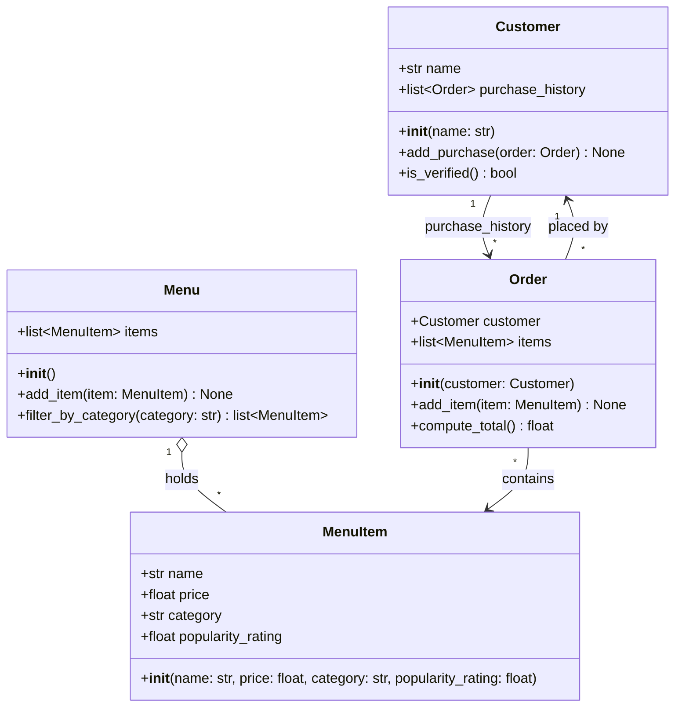

Here's the class diagram, based only on what [bytebites_spec.md](bytebites_spec.md) asks for:

## The four classes

- **Customer**: Stores a customer's name and their past orders, and `is_verified()` treats them as a real user if they have at least one past purchase.
- **MenuItem**: Holds one food item's name, price, category, and popularity rating.
- **Menu**: Holds every `MenuItem` the app sells and can filter them by category, such as "Drinks" or "Desserts".
- **Order**: Groups the items one customer picked into a single transaction, and `compute_total()` adds up their prices.

## Relationships

- **Menu → MenuItem** (aggregation, 1 to many): the menu holds items, but an item can exist without the menu.
- **Order → MenuItem** (many to many): an order contains several items, and the same item can be in many orders.
- **Customer ↔ Order**: each order belongs to one customer, and a customer's `purchase_history` is a list of their orders.

Two design choices go beyond the spec's wording:

- **Verification rule:** The spec says purchase history is used to check that customers are real users but doesn't say how. I used "has at least one past purchase." You can change that rule if you need something else.
- **Order-to-customer link:** I gave `Order` a reference to its `Customer` so each order is tied to whoever placed it. If you want a smaller diagram, you can remove that link and keep just the purchase history on `Customer`.